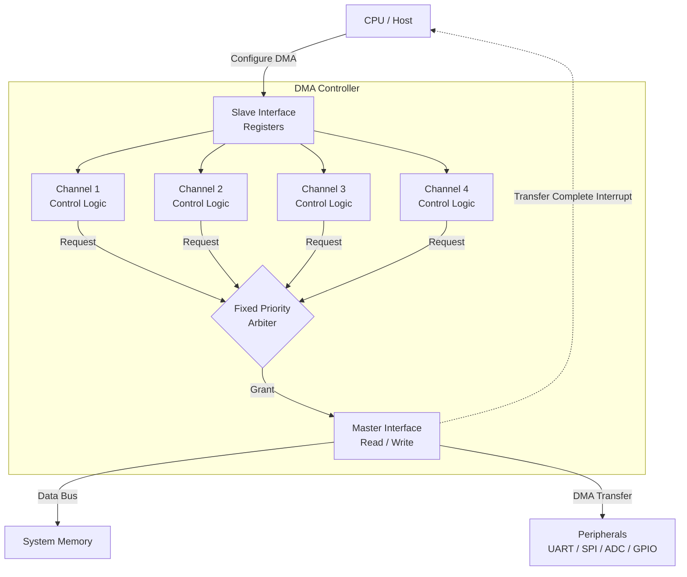
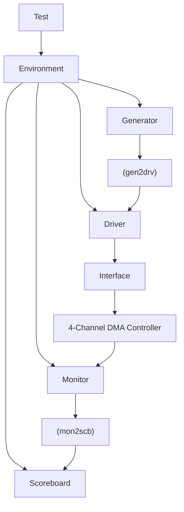

# Multi Channel DMA Controller Verification

## Project Objective
To verify a 4-channel DMA Controller using a SystemVerilog layered testbench architecture.

## Architecture Diagram (4-Channel DMA Controller)

## Verification Diagram 

## Verification Components
- Interface
- Transaction
- Generator
- Driver
- Monitor
- Scoreboard
- Environment
- Test

## Features
- Randomized Stimulus
- Mailbox Communication
- Functional Coverage
- Assertions (SVA)
- Fixed Priority Arbitration

## Tools
- SystemVerilog
- VS Code
- GitHub
- NC-Verilog / Xcelium
- Vivado Simulator

## **Author**
K Sanjana Nayaka 
